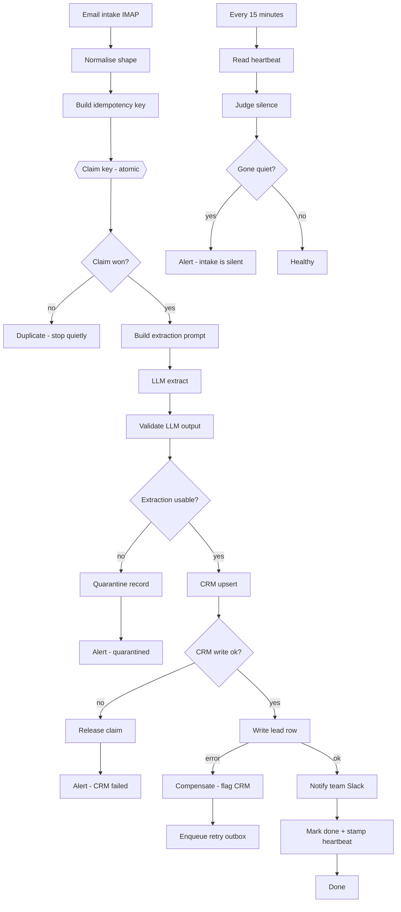

# Hardened lead pipeline for n8n

Three production-shaped n8n workflows (35 nodes total, 22 in the main chain) that turn
an inbound email into a scored CRM record — and, more importantly, **keep telling you
the truth when something breaks**.

Most published n8n examples show the happy path: trigger, call an API, write a row,
done. The interesting work is everywhere else. This repository is the everywhere else.

| File | Nodes | What it is |
|---|---|---|
| `workflows/01-lead-triage.json` | 22 | Email in → dedupe → LLM extraction → CRM → database → Slack |
| `workflows/02-silence-watchdog.json` | 7 | Notices when the intake has gone quiet |
| `workflows/03-error-handler.json` | 6 | One error workflow for every other workflow |

---

## The four problems this is built around

These are the questions that separate someone who has run an automation in production
from someone who has drawn one. Each has a named node in the JSON.

### 1. The trigger stops firing and nothing looks wrong

A trigger that dies produces **no execution**, therefore **no failed execution**,
therefore nothing in n8n's log. The log looks perfectly healthy. You find out days
later when someone asks where the leads went.

You cannot detect an absence by looking at a system that only records presences.

So the pipeline stamps a heartbeat row on every successful run
(`Mark done + stamp heartbeat`), and a **separate workflow on its own clock** reads
that row and alarms on staleness (`02-silence-watchdog.json`). It never consults n8n's
execution history, because in the failure we care about there is nothing there to read.

Two failure shapes are handled, not one:

- the heartbeat is **stale** → the pipeline stopped succeeding;
- the heartbeat row is **missing entirely** → it never ran at all. This is the case
  people forget, and it is the one that hides longest.

The threshold widens outside business hours. A watchdog that cries wolf every night
gets muted, and a muted watchdog is worse than none.

### 2. The same lead arrives twice

A retry, a double send, a re-delivered IMAP message. Two records in the CRM, two
notifications, and a salesperson calling the same person twice.

`Build idempotency key` hashes `message_id + from_email + subject` — deliberately
**not** the timestamp, because two identical mails a second apart are one event.

Then `Claim key (atomic)` does the real work:

```sql
INSERT INTO lead_claims (dedupe_key, claimed_at, status)
VALUES ('...', now(), 'processing')
ON CONFLICT (dedupe_key) DO NOTHING
RETURNING dedupe_key;
```

Two concurrent executions race here; exactly one gets a row back, the other gets
nothing and stops. **The claim is taken before any work happens, not after.** Checking
"have I seen this?" and then processing is a race with a window in it; claiming first
closes the window, and it is also what makes a crash halfway down the chain safe to
retry.

### 3. The CRM write succeeds and the database write then fails

The classic partial failure. The CRM now holds a contact your own system has never
heard of. Retrying the whole chain creates a second CRM contact; doing nothing loses
the lead quietly.

Neither. `Write lead row` has an error output wired to a **compensation branch**:

- `Compensate - flag CRM record` marks the CRM contact `sync_state=pending_local_write`,
  so the orphan is visible in the CRM instead of silently wrong;
- `Enqueue retry (outbox)` writes the payload to an outbox table that a separate
  worker drains.

The lead is never lost, the CRM is never silently inconsistent, and the retry is
idempotent because it still carries the same `dedupe_key`.

The mirror case is handled too: if the **CRM** write fails, `Release claim (CRM failed)`
returns the claim to a retryable state instead of leaving the lead stuck in
`processing` forever — a claim you never release is a lead you have quietly deleted.

### 4. The model returns something that is not the JSON you asked for

An LLM step is an untrusted input, exactly like a public form. Asking politely for
JSON is not a contract.

`Validate LLM output` refuses to pass anything downstream until:

- a JSON object can actually be extracted from the answer;
- `score` is a number in 0–100;
- `intent` is one of the four allowed values;
- `confidence` is at least 0.6.

Anything else goes to `Quarantine record` **with the raw answer kept**, and a human is
alerted. Quarantine, not discard: once the prompt is fixed, those leads can be replayed.
A dropped lead is indistinguishable from a lead that never existed.

---

## Flow



The watchdog is drawn detached on purpose. It shares **no trigger, no execution and no
log** with the pipeline it watches — that independence is the entire point.

---

## Running it

```bash
docker run -d --name n8n -p 5678:5678 \
  -v n8n_data:/home/node/.n8n n8nio/n8n:latest

# then, for each file
docker exec n8n n8n import:workflow --input=/home/node/.n8n/01-lead-triage.json
```

Set `03-error-handler` as the **Error Workflow** on the other two
(*Workflow settings → Error workflow*). That is what makes a failure anywhere land in
one place instead of every pipeline growing its own half-copied error branch that
drifts out of sync.

Two environment variables are read by the alert nodes:

```
ALERT_WEBHOOK_URL   where operational alarms go
SLACK_WEBHOOK_URL   where new qualified leads are announced
```

Credentials for IMAP, the LLM and the CRM are referenced by node and are **not**
included, for obvious reasons. Swap the CRM node for Pipedrive, Attio or a plain
HTTP endpoint without touching the rest of the chain: the pipeline depends on the
normalised shape produced by one node, not on the CRM's field names.

## Schema

```sql
CREATE TABLE lead_claims (
  dedupe_key     text PRIMARY KEY,
  status         text NOT NULL,           -- processing | done | quarantined | crm_failed
  claimed_at     timestamptz NOT NULL,
  completed_at   timestamptz,
  failure_reason text,
  llm_raw        text
);

CREATE TABLE leads (
  dedupe_key   text PRIMARY KEY REFERENCES lead_claims(dedupe_key),
  email        text, company text, contact_name text,
  intent       text, score int, crm_id text,
  created_at   timestamptz NOT NULL
);

CREATE TABLE pipeline_heartbeat (
  name         text PRIMARY KEY,
  last_success timestamptz NOT NULL
);

CREATE TABLE retry_outbox (
  id         bigserial PRIMARY KEY,
  dedupe_key text NOT NULL,
  payload    jsonb NOT NULL,
  reason     text,
  created_at timestamptz NOT NULL
);

CREATE TABLE pipeline_failures (
  id         bigserial PRIMARY KEY,
  workflow   text, node text, message text,
  severity   text,                        -- transient | hard
  dedupe_key text,
  failed_at  timestamptz NOT NULL
);

CREATE TABLE watchdog_alerts (
  id             bigserial PRIMARY KEY,
  name           text NOT NULL,
  silent_minutes int,
  raised_at      timestamptz NOT NULL
);
```

## Honest scope

These workflows import cleanly into n8n and the graph is complete end to end. They are
a **reference implementation of the failure handling**, not a turnkey product: wiring
them to a real inbox, a real CRM and a real database is the last mile, and the shape of
that last mile is what the schema above is for.

Everything here exists because the alternative was learned the hard way. The heartbeat
workflow in particular comes from a real incident: a mail watcher that had never once
fired its alert, and looked perfectly healthy for weeks, because nobody had checked
whether a signal that has never triggered actually works.

MIT licensed. Use it, fork it, tell me what breaks.

Need this wired to your own inbox, CRM and database? I do it at a fixed price, in writing:
[n8n workflow, built and handed over](https://contra.com/s/QqmlXN3F-your-n8n-workflow-built-tested-and-handed-over).
